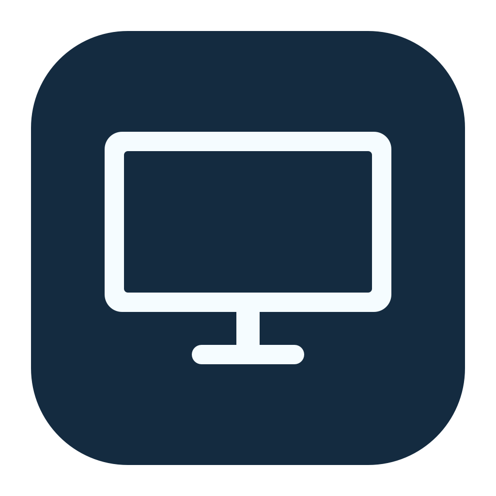

# DockMate



A native macOS menu bar utility for using a MacBook with external monitors.
Swift + AppKit, no third-party dependencies, no Dock icon, no network requests.
Requires macOS 13 or later and Xcode Command Line Tools to build.

## Why I built it

When I dock my MacBook, I like to keep the lid open so I can still use the Touch ID
fingerprint scanner. But I don't want the built-in screen on when I'm using external
monitors. I also prefer my mouse wheel to scroll in the opposite direction from
my trackpad.

DockMate solves both inconveniences with two simple menu bar controls: turn off
the built-in display with the lid open, and reverse mouse wheel scrolling without
changing the trackpad. It makes docking my laptop a little easier.

## Build and open

```sh
./scripts/build-app.sh
open build/DockMate.app
```

For everyday use, copy `build/DockMate.app` to `~/Applications` and open it there.
Keep the app in a stable location before granting Accessibility or enabling
Launch at Login. Local builds are ad-hoc signed; replacing the binary may require
removing and re-adding it under Accessibility. Developer ID signing is supported
by setting `DOCKMATE_SIGN_IDENTITY` when running the build script.

Click the monitor icon in the menu bar to open the compact control panel:

- **Reverse Mouse Scrolling** reverses wheel mouse scrolling relative to your
  macOS setting, including horizontal scrolling. Enable DockMate in System
  Settings → Privacy & Security → Accessibility when prompted. Reopen the menu
  after granting permission; restart the app if macOS requests it. The preference
  is remembered between launches.
- Switch **Built-in display** off to disable the laptop screen while the lid stays
  open. Requires an active external monitor. On your external screen, open
  DockMate and choose **Keep display off** within 15 seconds; otherwise the screen
  restores automatically. Switch **Built-in display** on to restore it.
- **Launch at Login** registers the app with macOS. Approve it in Login Items if
  macOS asks. This works from an app bundle, not `swift run`.

The panel follows your macOS light or dark appearance. Permission and recovery
messages appear only when needed. The footer's info button opens About; the power
button quits DockMate.

The panel is restored when the last active external monitor disconnects, before
sleep, after wake, and before normal quit. Recovery is retried if a restore fails;
quit is cancelled until the display can be restored. There is no automatic
disable on connection or wake: each off action starts a fresh trial.

## Recovery

If the app crashes while the panel is disabled, reopen it to restore the panel.
You can also restore without starting the menu bar app:

```sh
./build/DockMate.app/Contents/MacOS/DockMate --restore-display
```

This command enumerates disabled displays through SkyLight rather than relying
on a display ID saved before a hot-plug. If the app is no longer running, automatic
unplug recovery cannot run. Reopening the app or using the recovery command is
necessary after an abnormal exit. A restart is a fallback if macOS rejects recovery.

## Compatibility

Wheel mouse detection uses discrete scroll events. Trackpads, Magic Mouse, and
other devices/drivers that emit continuous scroll events retain their system
direction. Synthetic scroll events from other apps are also left alone. An app
that reads raw mouse hardware instead of macOS scroll events may bypass reversal.

Display control dynamically resolves the private `SLSConfigureDisplayEnabled`
and `SLSGetDisplayList` functions. These are unsupported by Apple and can change
with macOS releases. If unavailable, the display toggle is disabled and scrolling
still works. Configurations are applied for the current login session only.
This is a personal utility, not a Mac App Store build.

Implementation references:
[Apple Quartz Event Services](https://developer.apple.com/documentation/coregraphics/cgevent)
and [displaytoggle's SkyLight declarations](https://github.com/calvincchan/displaytoggle/blob/main/Sources/displaytoggle/SkyLightBridge.h).

## Icon artwork

The app includes a simple monitor icon and a matching monochrome
menu bar icon. Regenerate the committed assets on macOS with
`swift scripts/render-icons.swift`, then rebuild the app.

## Verification

```sh
swift test
./scripts/build-app.sh
./build/DockMate.app/Contents/MacOS/DockMate --diagnose
```

Tests exercise wheel delta reversal, trackpad/momentum/synthetic exclusions,
and the rules preventing the only screen from being disabled. `--diagnose` only
reads display state; it does not change hardware or request permissions.

To render the actual AppKit panel in six representative states in both light and
dark appearances without changing settings or display hardware:

```sh
./build/DockMate.app/Contents/MacOS/DockMate --preview-panel build/PanelPreviews
```

Hardware acceptance checks (with an external display attached):

1. Enable Accessibility, reverse a wheel mouse, and verify trackpad direction
   stays unchanged. Switch reversal off and verify original wheel behavior.
2. Turn the built-in display off and let the trial expire; verify it returns.
3. Repeat and choose Keep. Check windows move to the external screen, then unplug
   the external monitor and verify the laptop panel returns.
4. Repeat Keep, then sleep/wake and normal quit; verify recovery in both cases.
5. Verify recovery after forcibly terminating the app by reopening it or using
   `--restore-display`. Verify Launch at Login from the installed app bundle.

These checks require real monitor and mouse interaction; unit tests cannot
confirm a particular Mac's private display API behavior.
